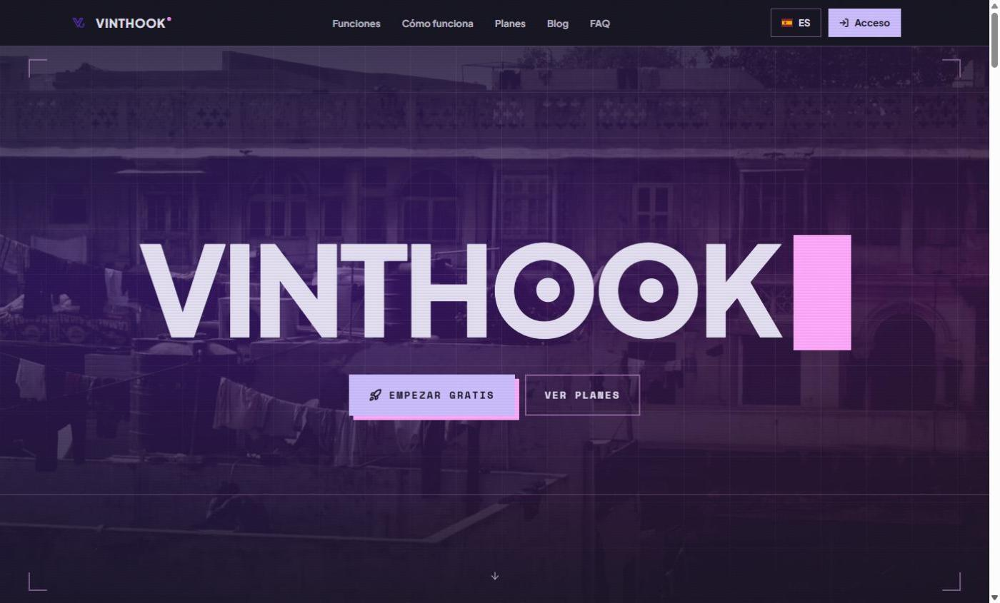
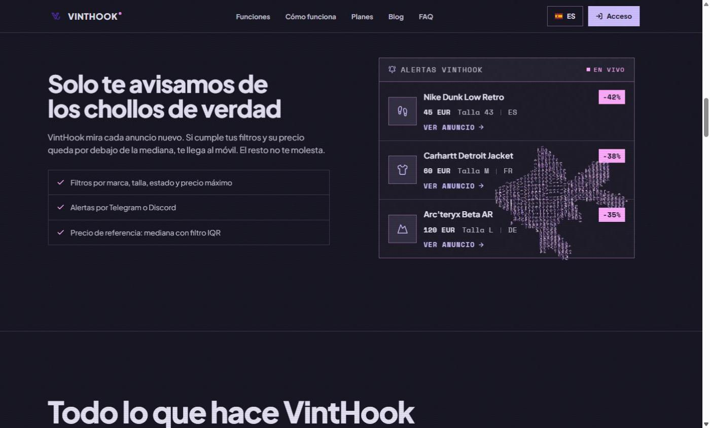
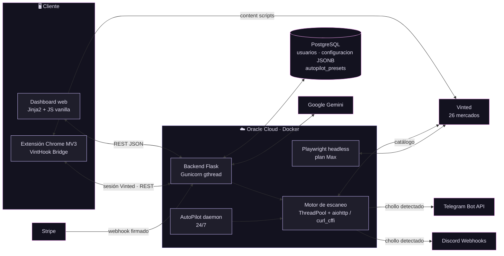
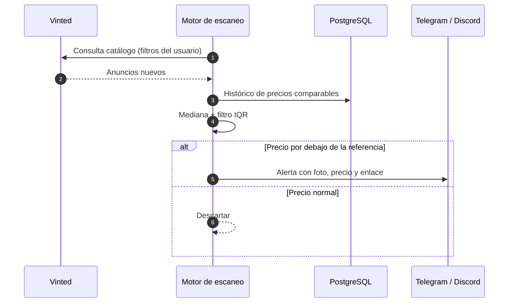

# VintHook

**Plataforma full-stack + extensión de navegador para detectar chollos en Vinted en tiempo real.**
*Full-stack platform + browser extension that spots underpriced Vinted listings in real time.*

  
  
  
  
   
  
  
  

  <a href="https://vinthook.com"><b>🌐 vinthook.com</b></a> ·
  <a href="https://mirandahidalgopablo-lab.github.io/Proyecto-VintHook/"><b>✨ Landing del proyecto</b></a> ·
  <a href="FichaTecnicaVintHook.html"><b>📄 Ficha técnica</b></a> ·
  <a href="DireccionVisualVintHook.html"><b>🎨 Dirección visual</b></a>

> En Vinted el chollo es de quien lo ve primero. **VintHook escanea cada anuncio nuevo de los 26 mercados de Vinted en menos de 300 ms**, lo compara con la mediana de precios de anuncios parecidos (filtro IQR) y te avisa al instante por Telegram o Discord, mientras un AutoPilot sigue trabajando 24/7 en el servidor.

---

## 🎬 Preview

https://github.com/user-attachments/assets/2ee3b712-361c-46db-94d0-4cc10daea48e

<table>
  <tr>
    <td width="50%"></td>
    <td width="50%"></td>
  </tr>
  <tr>
    <td align="center">Landing · vinthook.com</td>
    <td align="center">Feed de alertas con descuento sobre la mediana</td>
  </tr>
</table>

---

## ✨ Características

| | Feature | Detalle |
|---|---|---|
| ⚡ | **Tracking automatizado** | Búsqueda concurrente (`ThreadPool` + `aiohttp` / `curl_cffi`) en los 26 dominios de Vinted, con rate-limiting, reintentos y rotación de proxies. |
| 🎯 | **Filtros personalizados** | Marca, talla, estado, precio máximo y país. Matching difuso de títulos con `thefuzz`. |
| 📉 | **Detección de chollos real** | Precio de referencia por mediana con filtrado de outliers por **IQR**: solo avisa de lo que está por debajo de mercado. |
| 🔔 | **Alertas instantáneas** | Notificaciones con foto, precio y enlace directo vía **Telegram Bot API** y **Discord webhooks**. |
| 🤖 | **AutoPilot 24/7** | Daemon en servidor con presets guardados (JSONB): sigue buscando con el ordenador apagado. |
| 🧩 | **Extensión de navegador** | *VintHook Bridge* (Chrome, Manifest V3) conecta tu sesión de Vinted para publicar, editar y comprar desde la plataforma. |
| 🧠 | **IA integrada** | Google **Gemini** con salida JSON estructurada (búsqueda por imagen, análisis de anuncios). |
| 💳 | **SaaS completo** | Google OAuth 2.0, verificación por email, planes Free / Pro / Max con **Stripe** (checkout + webhooks firmados) y web multilingüe ES/EN. |

---

## 🏗️ Arquitectura

### Flujo de una alerta

---

## 🧰 Tech Stack

| Capa | Tecnologías |
|---|---|
| **Backend** | Python 3.11 · Flask 3 · Gunicorn (gthread) · Jinja2 · Whitenoise |
| **Base de datos** | PostgreSQL (psycopg2, pool de conexiones, JSONB) |
| **Scraping / concurrencia** | aiohttp · curl_cffi (impersonación de navegador) · ThreadPool · rotación de proxies |
| **Automatización** | Playwright + stealth · Xvfb · AutoPilot daemon |
| **Frontend** | HTML5 · CSS3 · JavaScript vanilla · diseño *Lumina Noir* (dark-first, glassmorphism) |
| **Extensión** | Chrome Extension Manifest V3 (service worker, content scripts, popup) |
| **Integraciones** | Telegram Bot API · Discord Webhooks · Stripe · Google OAuth 2.0 · Google Gemini |
| **DevOps** | Docker · GitHub Actions (deploy por SSH) · Oracle Cloud (Ubuntu ARM) |
| **Seguridad** | Cifrado de datos sensibles (`cryptography`/Fernet) · CSP · rate limiting · webhooks firmados |

Hecho por **[Pablo Miranda Hidalgo](https://github.com/mirandahidalgopablo-lab)** · [LinkedIn](https://www.linkedin.com/in/pablo-miranda-hidalgo) · [vinthook.com](https://vinthook.com)

Distribuido bajo licencia MIT. VintHook no está afiliado a Vinted.

